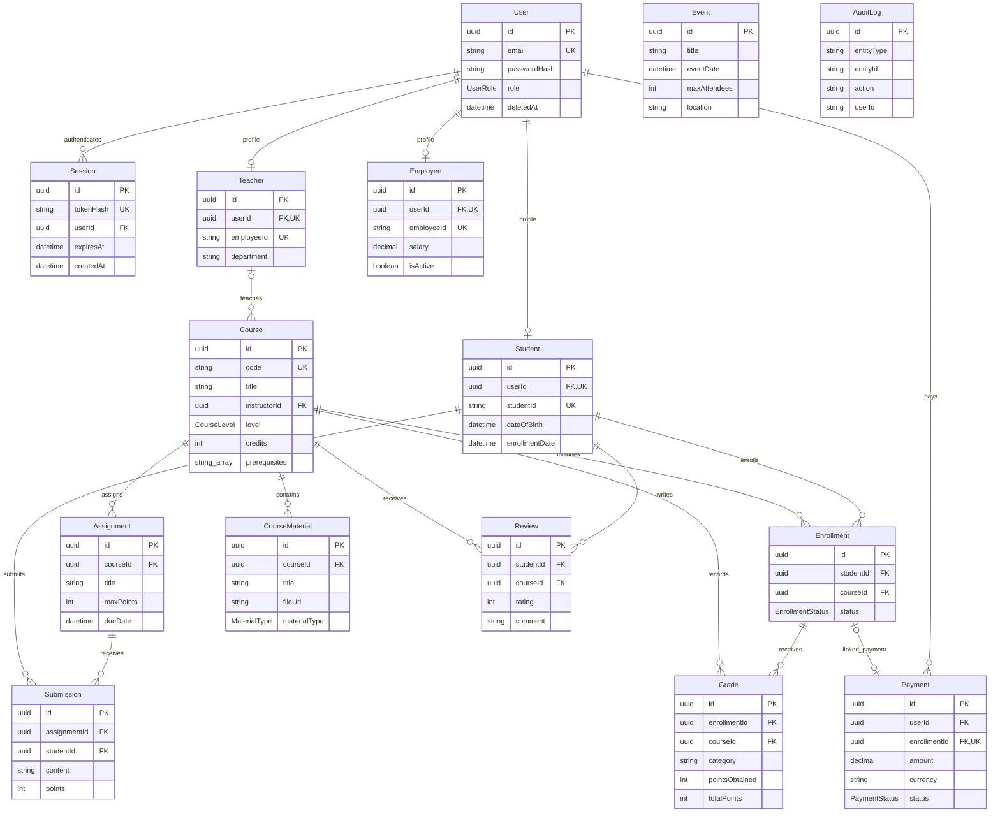

# School data model

The authoritative field definitions, enums, defaults, indexes, and database constraints are in [prisma/schema.prisma](../prisma/schema.prisma). All primary keys are generated UUID strings. Foreign keys reference the UUID primary key, even where a model also has a human-readable identifier such as `Student.studentId`.

`Event` and `AuditLog` are standalone tables. `AuditLog.userId` and `entityId` are descriptive strings, not enforced foreign keys. `Payment.enrollmentId` is optional and unique: each payment can link to at most one enrollment and each enrollment to at most one payment. Student, teacher, and employee profiles are individually optional and unique per user; the schema does not forbid a user having multiple profile types.

A course's instructor is optional. The API does not enforce additional relationships across independent foreign keys: for example, clients must ensure a grade's course matches its enrollment's course. The database does not enforce one enrollment or one review per student/course pair. Delete operations are hard deletes; relation constraints can return `409` when dependent records exist. Setting `User.deletedAt` does not filter subsequent reads automatically.

`Session` is the additional authentication model alongside the original 14 school models. It stores only the SHA-256 hash of the random cookie credential. User deletion cascades to sessions; expiry is enforced on every request. Role/password/deletion-state changes explicitly revoke target sessions transactionally.
