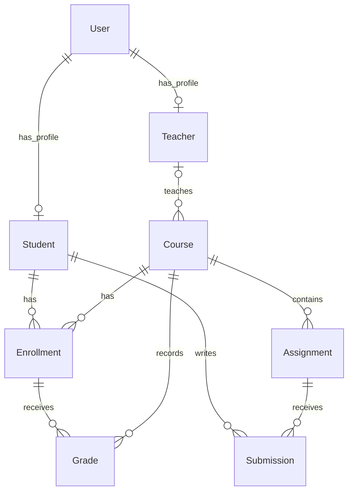
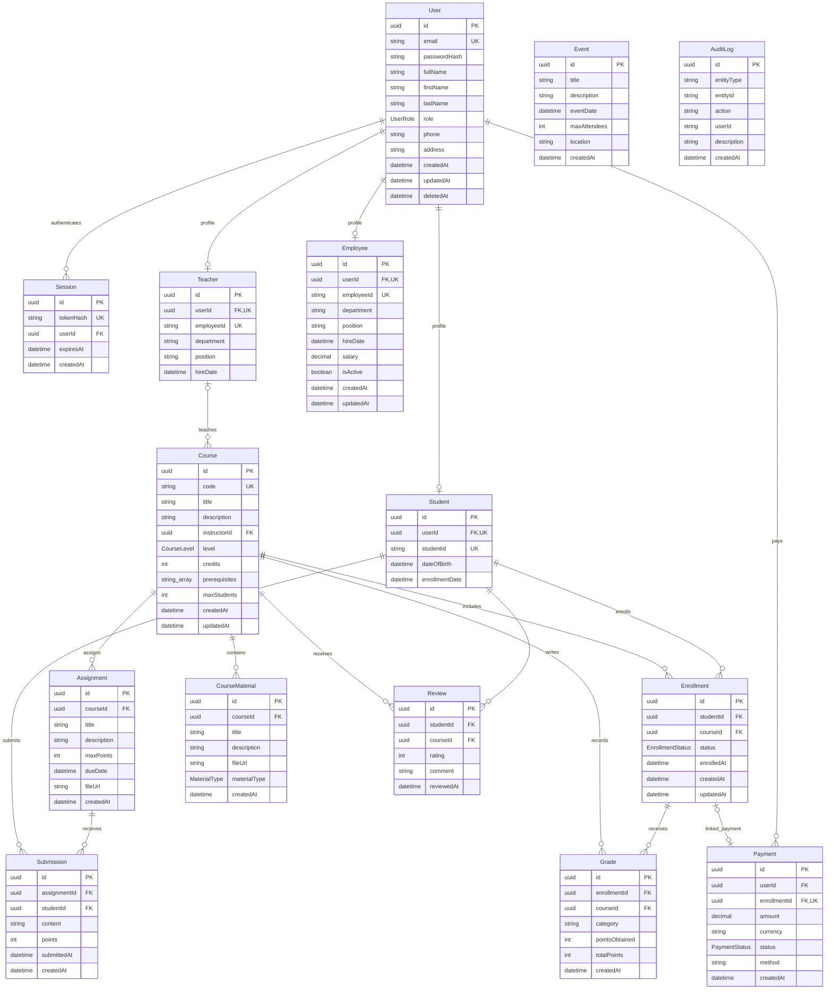

# School database tables and relationships

The database has **15 tables**: 14 school tables and one table for login sessions. The diagrams below describe the current [Prisma schema](../prisma/schema.prisma). For the application folders and request flow, see [project structure](project-structure.md).

## How to read the diagrams

| Symbol | Meaning | Example |
| --- | --- | --- |
| `PK` | Primary key: identifies one row | `Course.id` |
| `FK` | Foreign key: references another table's primary key | `Assignment.courseId` references `Course.id` |
| `UK` | Unique key: non-null values cannot repeat | `User.email` |
| `||` | Exactly one | Every assignment belongs to one course |
| `o|` | Zero or one | A course may have no teacher or one teacher |
| `o{` | Zero or many | A course can have many assignments |

IDs are UUID-formatted strings generated by Prisma using `@default(uuid())`. The `uuid` type in these diagrams describes their format; the current PostgreSQL columns are text, not native PostgreSQL UUID columns. Foreign keys reference `id`, including where a table also has a display code such as `Student.studentId`.

## Main school workflow

Start with this smaller diagram when presenting the project. The complete diagram follows it.

A teacher teaches courses. An enrollment connects a student to a course, so many students can join many courses. Each course contains assignments, each submission connects a student to an assignment, and grades reference an enrollment and a course.

## Complete database diagram

All 15 tables and all scalar columns are shown below. Nullable columns are explained in the schema and API reference; the `o|` relationship marker shows optional parent relationships.

## Model names and actual table names

Prisma uses singular model names in code and maps them to these PostgreSQL tables:

| Prisma model | PostgreSQL table | Purpose |
| --- | --- | --- |
| User | `users` | Account, role, contact details, password hash |
| Student | `students` | Student profile linked to one user |
| Teacher | `teachers` | Teacher profile linked to one user |
| Employee | `employees` | Employee profile linked to one user |
| Course | `courses` | Course details and optional teacher |
| Enrollment | `enrollments` | Student membership in a course |
| Assignment | `assignments` | Coursework belonging to a course |
| Submission | `submissions` | Student answer to an assignment |
| Grade | `grades` | Score category linked to enrollment and course |
| CourseMaterial | `course_materials` | Learning resource belonging to a course |
| Payment | `payments` | User payment record, optionally linked to enrollment |
| Review | `reviews` | Student feedback on a course |
| Event | `events` | Standalone school event |
| AuditLog | `audit_logs` | Manually maintained descriptive audit record |
| Session | `sessions` | Hashed session credential, user, and expiry |

## Relationship rules and limitations

`Event` and `AuditLog` are standalone tables. `AuditLog.userId` and `entityId` are descriptive strings, not enforced foreign keys. `Payment.enrollmentId` is optional and unique: each payment can link to at most one enrollment and each enrollment to at most one payment. Student, teacher, and employee profiles are individually optional and unique per user; the schema does not forbid a user having multiple profile types.

A course's instructor is optional. The API does not enforce additional relationships across independent foreign keys: for example, clients must ensure a grade's course matches its enrollment's course. The database does not enforce one enrollment or one review per student/course pair. Delete operations are hard deletes; relation constraints can return `409` when dependent records exist. Setting `User.deletedAt` does not filter subsequent reads automatically.

`Session` is the additional authentication model alongside the original 14 school models. It stores only the SHA-256 hash of the random cookie credential. User deletion cascades to sessions; expiry is enforced on every request. Role/password/deletion-state changes explicitly revoke target sessions transactionally.

Most required foreign keys restrict parent deletion. Two optional relations instead become null when their parent is deleted: `Course.instructorId` when a teacher is deleted and `Payment.enrollmentId` when an enrollment is deleted. Other dependent rows may still prevent the operation. See the [Postman guide](../POSTMAN-TESTING.md#11-delete-all-sample-records-in-dependency-order) for a practical deletion order.

`Course.prerequisites` stores an array of course-code strings. It is not an enforced foreign-key relationship. Enum columns such as `User.role` and `Course.level` have fixed allowed values; enums are not separate tables.

Open this Markdown file in a Mermaid-enabled preview or view it on GitHub to see the rendered diagrams. The [Prisma schema](../prisma/schema.prisma) remains the source of truth for types, nullable fields, defaults, and constraints.
