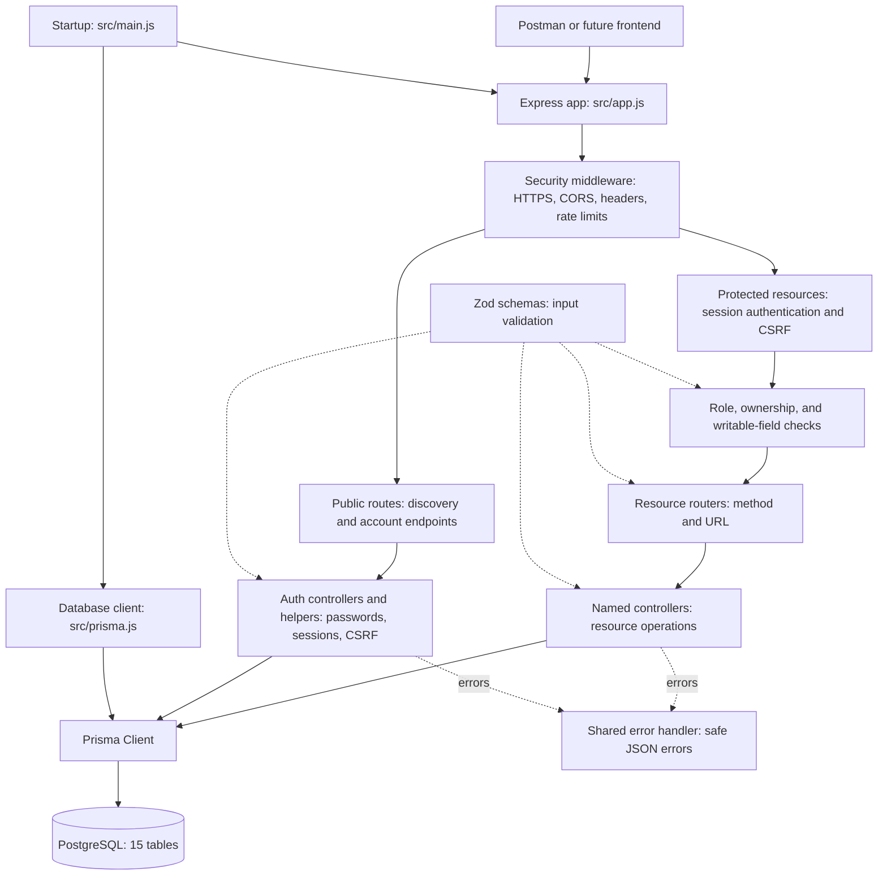
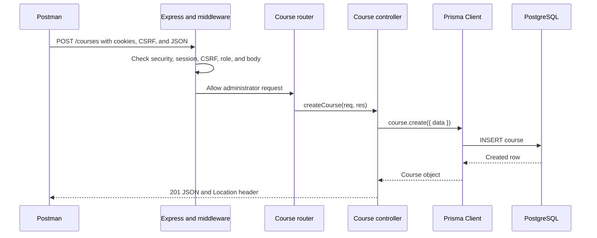

# School API project structure

The application receives HTTP requests, checks access and input, runs database queries, and returns JSON. The database tables are explained in the [database diagram](data-model.md).

## Application structure



This is a responsibility diagram. Input checks happen at different points: middleware validates permissions and writable fields, resource routers check UUID parameters, and controllers parse pagination or request bodies where needed. Public registration and login have their own CSRF, rate-limit, and body-validation handling.

## Folder structure

```text
it-school/
├── src/
│   ├── main.js              Start server, connect database, handle shutdown
│   ├── app.js               Configure Express and mount middleware/routes
│   ├── prisma.js            Create the shared Prisma database client
│   ├── routes/              HTTP paths and methods for each resource
│   ├── controllers/         CRUD queries and account operations
│   ├── middleware/          Authentication, permissions, security, errors
│   ├── auth/                Passwords, cookies, CSRF, bootstrap helpers
│   ├── validation/          Zod request and configuration schemas
│   ├── config/              Read validated server/security configuration
│   └── generated/prisma/    Generated client; recreated by db:generate
├── prisma/
│   ├── schema.prisma        Tables, fields, relationships, and enums
│   ├── migrations/          SQL changes applied to the database
│   └── seed.js              Development sample data
├── scripts/                 Administrator bootstrap and session cleanup
├── test/                    HTTP, validation, security, and database tests
├── deploy/Caddyfile         HTTPS reverse proxy configuration
├── docs/                    API, security, plans, and diagrams
├── prisma7.config.ts        Prisma CLI and migration configuration
├── .env.example             Environment template without real credentials
├── package.json             Dependencies and npm commands
├── README.md                Setup and project introduction
└── POSTMAN-TESTING.md        Copyable manual API tests
```

## Example request through the application



If validation fails, the API returns 400 before creating a row. Missing authentication returns 401; forbidden actions or invalid CSRF return 403. Known database conflicts return 409 through the shared error handler.

## Short presentation explanation

“Routes connect an HTTP method and URL to a controller. Middleware checks security and permissions. Zod checks request input. Controllers use Prisma to read or change PostgreSQL records and return JSON. The schema describes our tables and relationships, and migrations apply those definitions to the database.”

Open this file in a Mermaid-enabled Markdown preview or on GitHub to see the diagrams.
